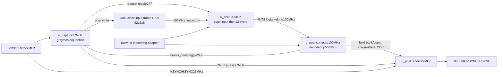

# Vivado 인수인계 가이드 — pixel27MHz / NPU100MHz

## NPU 스펙 요약

| 항목 | 사양 |
|---|---|
| 용도 | 96×96 grayscale 영상의 사람 검출과 bbox overlay |
| 센서 입력 | DVP VSYNC envelope + HSYNC line-valid + pixel data; gray8/RGB888/병렬 RGB565 선택 |
| NPU 입력 | 1×1×96×96 signed INT8; 입력 adapter가 gray 변환·축소·letterbox·양자화 수행 |
| 네트워크 | student_kd 전체13 convolution +skip concat +nearest ×2 upsample; BatchNorm folding |
| 수치 형식 | float 학습, INT8 weight/activation, INT32 bias/누산, INT64 재양자화 중간값 |
| **모델 parameter 수** | **90,094개 =weight89,820 +bias274**; 양자화 저장량90,916bytes |
| 별도 실행 설정 | INT32 multiplier274,32bit descriptor208words,16bit sigmoid/quality LUT1536 |
| preload 전체 | 92,112elements, data95,916bytes; space별 항목 폭이 다름 |
| NPU raw 출력 | 1×6×24×24 =3456개 INT8 logits: heatmap/offset_x/offset_y/width/height/quality |
| bbox 출력 | 최대50개, threshold·최소 크기·top50·NMS 후 inclusive96좌표 xyxy +Q0.16 score |
| 영상 출력 | RGB888 +VSYNC/HSYNC; 완료된 박스를 다음 게시 가능한 프레임부터 빨간색으로 그림 |
| 연산량 | 20,321,280 MACs/frame, 순차 MAC 엔진 |
| **SRAM** | **220,332bytes(약215.17KiB)** =NPU210,348 +post9,984; 작은 후보/박스 register 약1.8KB 별도 |
| pixel clock | `clk_pixel`27MHz,37.037037ns: DVP/capture/영상 render |
| compute clock | `clk_npu`100MHz,10ns: input copy/NPU/후처리/preload/설정/debug |
| CDC | dual-clock input frame SRAM9216bytes +frame request/completion toggle2FF +bbox bank publication request/ack |
| NPU 시간/FPS | 입력 복사18,432 포함40,965,537clocks,100MHz409.655ms,코어 상한2.4411FPS |
| 시스템 처리율 | 후처리 포함 대표 TB 약409.834ms/2.4400FPS 상한; capture·padding·센서 VSYNC 대기는 추가 |
| 백업 | `orig/`에 전체 원본 프로젝트 보존; 아래 사양은 두 클록 변경본 |

FPGA의 실제 BRAM 반올림 용량·면적·100MHz timing은 Vivado 보고서로 확인해야 한다. 이 문서는 디지털 시뮬레이션과 구현 계약을 설명하며 물리 CDC/STA 통과를 주장하지 않는다.

## 1. 범위와 파일 기준

경로는 프로젝트 루트 기준이다. 원래 경로는 `/home/jinyoung/2026_TEACH_CNN/codex_opencode_loop/advance_network`다. 현재 top은 `person_detector_top`이고 직속 instance는 `u_capture/u_npu/u_post` 세 개다. 합성용 소스는 Verilog-2005다. 기존 AGENTS.md의 RTL 제외 지시는 이번 사용자의 RTL·합성·CDC 구현 요청으로 대체된다.

**원본 DC 결과는 현재 변경본의 합성 결과가 아니다.** `design_compiler/rtl_snapshot/` 원본 단일27MHz RTL은 analyze 통과 후 NPU elaboration1800초 timeout(exit124)으로 끝났다. mapped netlist/area/timing은 생성되지 않았다. 자세한 내용은 `../design_compiler/synthesis_result.md`다. 최신 두 클록 변경본은 bbox 후보 순차 scan과 NMS5단계 분할 후 SRAM8개를 제외한 DC 최적화 합성을 완료했다. [블랙박스 합성 결과](../design_compiler/blackbox_synthesis_result.md): 표준셀 면적86321.545900µm², NPU100MHz setup slack+4.81ns, pixel27MHz+29.45ns, setup/hold 위반0개다. `compile` 및 `set_fix_hold`를 사용했고 기존 주기·I/O·SRAM 경계 예산은 유지했고 pixel/NPU는 명시적인 asynchronous group으로 선언했다. 양방향 CDC STA는 No paths이고 bbox20ns는 구현 제약에서 제거해 별도 settling audit으로만 확인했다. SRAM 모델이 없어 min-capacitance 경고103개가 남아 있다. 실제 SRAM/배치·배선 또는 Vivado timing 통과를 의미하지 않는다. [분할·검증 보고서](../design_compiler/timing_slice_result.md)를 참고한다.

## 2. 가져갈 데이터

| 종류 | 전달 파일 | 필요성 |
|---|---|---|
| RTL | `rtl/person_detector_top.v`, `dvp_capture.v`, `npu_core.v`, `bbox_overlay.v` | 합성 필수, 모두 최신 두 클록 버전 |
| parameter | `rtl/generated/weights.hex`, `bias.hex`, `requant.hex`, `descriptors.hex`, `post_lut.hex` | 추론 전 SRAM 초기화 필수 |
| metadata | `rtl/generated/manifest.json`, `quantization_report.json` | depth/주소/scale/양자화 근거 |
| 합성 자료 | `rtl/vivado_synth.tcl`, `rtl/constraints/dualclock_cdc.tcl`, `rtl/files.f`, `rtl/*.md` | clocks·CDC·BRAM 구현 기준 |
| regression | `rtl/tb/`, `rtl/tools/`, generated input/golden 파일, `rtl/results/` | 검증 재현 시 추가 |
| 새 이미지 TB | `image/`, `models/advanced_model.py` | test_image.py가 exporter 함수를 import하므로 Torch import도 필요 |

현재 frozen parameter로 합성·추론하는 데 학습 dataset이나 checkpoint는 필요 없다. `--export`로 재생성하려는 경우에만 checkpoint/model/calibration 자료가 필요하다. 모델과 LUT를 임의 재calibration하지 않는다.

`rtl/` 전체를 전달하면 가장 간단하다. `rtl/build/`의 바이너리는 환경별로 재빌드한다. `orig/`는 역사적 원본 백업이며 최신 synthesis source에 섞지 않는다. `.venv`는 OS 간 복사 대신 새 환경에 설치하고 도구의 `.venv/bin/python` 경로를 맞춘다. 검증 환경은 Verilator4.038,Torch2.5.1+cpu,NumPy2.2.6,Pillow11.3.0이다.

## 3. 블록 다이어그램



입력 frame RAM은 `u_npu` 내부다. NPU의108288×8 activation RAM은100MHz에서만 read/write하며 다른 clock의 두 writer가 같은 array를 쓰지 않는다.

Vivado IP Integrator에서 top을 Module Reference 또는 IP로 배치하고 sensor PCLK를 `clk_pixel`, 안정된100MHz를 `clk_npu`에 연결한다. Clocking Wizard/MMCM은 외부 board wrapper에서 구성하며 top 내부에는 PLL이 없다. clock 안정 후 reset을 해제하면 top 내부에서 각 domain별로 동기 release한다.

대용량 메모리는 먼저 ram_style을 통한 BRAM inference를 확인한다. 명시적 Block Memory Generator를 쓰려면 내부 array read/write를 native IP port로 교체한다. top 옆에 BRAM IP를 추가하는 것만으로 내부 RAM이 대체되지는 않는다. I2C slave/AXI adapter/HDMI PHY는 포함되어 있지 않다.

## 4. Top 설정·포트·CDC 계약

### Compile-time parameter

| parameter | default | 내용 |
|---|---:|---|
| `p_sensor_width` | 96 | 센서 유효pixel/line |
| `p_sensor_height` | 96 | 센서 유효line/frame |
| `p_input_type` | 0 | 0=gray8(low8),1=RGB888,2=parallel RGB565(low16) |

해상도를 바꿔도 NPU 입력은96×96이다. scaler는 integer nearest 축소+gray114 중앙padding으로 기존 JPG 전처리 LANCZOS와 filter가 다르다. 극단적 해상도/종횡비는16bit counter 외에 좌표 역변환32bit 산술 범위도 확인한다.

### Clock/reset과 domain별 포트

| domain | 포트 |
|---|---|
| 공통reset | `rst_n`: 두 domain 동시 active-low assert, top 내부2FF로 개별 동기 release. 한쪽만 독립 reset은 미지원 |
| pixel27MHz | `clk_pixel`, `i_vsync/i_hsync/i_data[23:0]`, `o_vsync/o_hsync/o_rgb[23:0]`, `o_ready/o_busy/o_frame_error` |
| NPU100MHz preload | `i_load_we[0:0]`, `i_load_space[2:0]`, `i_load_addr[17:0]`, `i_load_data[31:0]` |
| NPU100MHz config | `i_cfg_we`, `i_cfg_addr[7:0]`, `i_cfg_wdata[31:0]`, `o_cfg_rdata[31:0]` |
| NPU100MHz raw | `o_result_valid/index[11:0]/data[7:0]`, `o_npu_done` |
| NPU100MHz bbox | `o_box_valid`, `o_box_x1/y1/x2/y2[6:0]`, `o_box_score[15:0]`, `o_boxes_done` |

입력RGB888은{R8,G8,B8}, RGB565는{R5,G6,B5}를 병렬16bit로 받는다. 두 byte를 두 clock에 받는 센서는 외부 pixel 조립이 필요하다. gray 변환은 `(77R+150G+29B+128)>>8`이다. VSYNC high가 frame 전체를 감싸며 HSYNC는 line-valid, high 한 clock에 한 pixel이다. 첫 pixel 전·line 사이·최종line 후 VSYNC falling 전에 최소 한 pixel clock blank를 둔다. 극성·pulse 형식이 다르면 adapter에서 변환한다.

`o_ready`는 capture의 새 VSYNC 수신 준비 상태다. `o_busy`는 NPU/post busy를 pixel로2FF 동기화한 값과 capture 상태의 OR다. pending 공개 대기라면 ready=1,busy=1일 수 있다. busy가0이 될 때까지 VSYNC를 막으면 pending 공개가 불가능해질 수 있으므로 bypass sync는 계속 전달한다.

### CDC 소유권

1. capture 완료 후 pixel request toggle을 NPU2FF로 동기화해 start pulse를 만든다.
2. capture는WAIT에서 input frame SRAM write를 멈춘다. NPU는9216byte를18432clocks에 activation으로 복사한 뒤 원래 그래프를 실행한다.
3. boxes_done을 NPU toggle→pixel2FF로 되돌린 후에만 capture가 padding 준비를 재개한다. 개별 input byte2FF나 비동기busy write gating은 쓰지 않는다.
4. post는 inactive bbox bank를 작성한 뒤 bank/count를 고정하고 request를 보낸다. pixel은 동기화된 요청과 다음VSYNC에서만 bank를 교체한다.
5. pixel ack가NPU2FF를 되돌아오기 전까지 payload를 변경하지 않는다. active bank는 쓰지 않는다. overlay enable도pixel2FF를 거친다.

이는 디지털 protocol이며 analog metastability/MTBF를RTL simulation만으로 증명하지 않는다. 동기기의stage1→stage2는 destination clock으로 timing을 확인한다. 상세는 `DESIGN_DUALCLOCK.md`, `DESIGN_POST.md`를 참고한다.

## 5. preload 주소 체계와 실제 데이터 — 100MHz domain

**전역 메모리 byte 주소는 구현되어 있지 않다.** 현재 주소는 `(i_load_space, i_load_addr)`의 조합이다. `i_load_addr`는 선택된 SRAM의 **element index**다. INT32 메모리도 `0,1,2,...`로 증가한다.

| space | 대상 SRAM | 파일 | depth × width | 유효 index (10진수) | 마지막 index (16진수) |
|---:|---|---|---|---|---|
| 0 | `u_npu.weight_mem` | `weights.hex` | 89820 × 8 | 0~89819 | `0x15EDB` |
| 1 | `u_npu.bias_mem` | `bias.hex` | 274 × 32 | 0~273 | `0x00111` |
| 2 | `u_npu.descriptor_mem` | `descriptors.hex` | 208 × 32 | 0~207 | `0x000CF` |
| 3 | `u_npu.multiplier_mem` | `requant.hex` | 274 × 32 | 0~273 | `0x00111` |
| 4 | `u_post.lut_mem` | `post_lut.hex` | 1536 × 16 | 0~1535 | `0x005FF` |

각 `.hex`의 첫 줄은 index 0, 두 번째 줄은 index 1이다. 각 줄은 16진수 element 하나이며 8bit는 두 자리, 16bit는 네 자리, 32bit는 여덟 자리다. signed 값은 2의 보수 비트열이다. hex 파일은 raw binary 파일이 아니다.

- weight는 `i_load_data[7:0]`, LUT는 `[15:0]`만 사용한다. 상위 비트는 0으로 보내면 된다.
- bias와 multiplier는 `[31:0]` 전부 사용한다. `0xFFFFFFFD`는 INT32 -3이다.
- weight는 OIHW 순서다. index=`weight_base + (((oc*Cin + ic)*K + ky)*K + kx)`.
- bias와 multiplier는 같은 `parameter_base+oc` index를 사용한다.
- space=4는 top에서 address low11만 전달하므로 상위 address bit는 0으로 보내야 한다. 범위 밖 주소를 보내 alias에 의존하지 않는다.
- bus에 ready/ack 또는 weight readback은 없다. 각 rising edge에 write가 처리된다. `i_load_we`를 매 클록 high로 유지하고 address/data를 바꾸면 연속 preload가 가능하다.
- I2C의 byte 순서는 아직 정해져 있지 않다. I2C wrapper가 수신 byte들을 원하는 32bit 값으로 조립한 뒤 write pulse를 만들어야 한다. byte write가 자동 지원되는 bus는 아니다.

### preload 예시

```verilog
// weight[10] = -3
// clk rising edge 전에 안정된 값으로 구동한다.
i_load_we    = 1'b1;
i_load_space = 3'd0;
i_load_addr  = 18'd10;
i_load_data  = 32'h0000_00FD;

// bias[12] = -3
i_load_space = 3'd1;
i_load_addr  = 18'd12;
i_load_data  = 32'hFFFF_FFFD;
```

실제 구현에서는 loader가 다섯 파일의 전체 항목을 순서대로 쓴다. 총 **92,112 write clocks**, 100MHz에서 **0.92112ms**의 순수 bus 시간이다. 통신 전달 시간과 항목 간 대기 시간은 별도다.

### 레이어별 데이터 주소표

아래 모든 구간은 **양끝 포함**, 10진수 element index다. descriptor 주소는 space2, weight는 space0, bias/multiplier는 각각 space1/3이다.

| layer index | 이름 | descriptor index | weight index | bias/multiplier index |
|---:|---|---|---|---|
| 0 | `c1` | 0~15 | 0~107 | 0~11 |
| 1 | `c2` | 16~31 | 108~2699 | 12~35 |
| 2 | `c3` | 32~47 | 2700~9611 | 36~67 |
| 3 | `c4` | 48~63 | 9612~23435 | 68~115 |
| 4 | `context` | 64~79 | 23436~44171 | 116~163 |
| 5 | `fuse1` | 80~95 | 44172~67211 | 164~195 |
| 6 | `fuse2` | 96~111 | 67212~79307 | 196~219 |
| 7 | `head` | 112~127 | 79308~84491 | 220~243 |
| 8 | `regression` | 128~143 | 84492~89675 | 244~267 |
| 9 | `heatmap` | 144~159 | 89676~89699 | 268~268 |
| 10 | `offset` | 160~175 | 89700~89747 | 269~270 |
| 11 | `size` | 176~191 | 89748~89795 | 271~272 |
| 12 | `quality` | 192~207 | 89796~89819 | 273~273 |

### descriptor의 16 words

레이어 `L`의 field `F`는 `i_load_space=2`, `i_load_addr=16*L+F`로 쓴다. FPGA/AXI wrapper가 byte addressing을 선택하면 wrapper에서만 `4*(16*L+F)`로 변환한다. 원래 preload port에 4배 주소를 직접 보내면 안 된다.

| field | 내용 |
|---:|---|
| 0 | 첫 번째 입력 tensor의 activation SRAM base |
| 1 | skip 입력 tensor의 activation SRAM base; 없으면 0 |
| 2 | 출력 tensor activation SRAM base |
| 3 | weight SRAM base |
| 4 | bias/multiplier SRAM 공통 base |
| 5, 6 | convolution 논리 입력 width, height |
| 7 | 첫 입력 channel 수 |
| 8 | 두 번째 skip 입력 channel 수; 없으면 0 |
| 9, 10 | 출력 width, height |
| 11 | 출력 channel 수 |
| 12 | kernel width, 현재 1 또는 3 |
| 13 | stride, 현재 1 또는 2 |
| 14 | 첫 입력 nearest ×2 upsample enable |
| 15 | 출력 ReLU enable |

예: c1의 descriptor 0~15는 `[0,0,9216,0,0,96,96,1,0,48,48,12,3,2,0,1]`다. fuse1/fuse2는 field5/6이 upsample 후 논리 입력 크기이고 field0의 첫 tensor는 실제로 그 절반 해상도다. 주소 발생기가 이를 처리한다.

descriptor는 현재 그래프용이다. RTL controller의 마지막 layer는 index12, 결과 출력은 고정 3456 elements이므로 descriptor만 바꿔 임의 네트워크를 실행하는 범용 ISA로 취급하지 않는다.

### activation SRAM 배치

`u_npu.activation_mem`은 108288×8이다. input/중간 tensor/최종 output이 같은 물리 메모리의 다른 영역을 쓴다. 각 tensor 내부는 CHW, index=`base+(channel*height+y)*width+x`다. INT32 partial sum을 SRAM에 저장하지 않는다.

| tensor | CHW | activation index 구간 |
|---|---|---|
| input | 1×96×96 | 0~9215 |
| `c1` | 12×48×48 | 9216~36863 |
| `c2` | 24×24×24 | 36864~50687 |
| `c3` | 32×12×12 | 50688~55295 |
| `c4` | 48×6×6 | 55296~57023 |
| `context` | 48×6×6 | 57024~58751 |
| `fuse1` | 32×12×12 | 58752~63359 |
| `fuse2` | 24×24×24 | 63360~77183 |
| `head` | 24×24×24 | 77184~91007 |
| `regression` | 24×24×24 | 91008~104831 |
| `heatmap` | 1×24×24 | 104832~105407 |
| `offset` | 2×24×24 | 105408~106559 |
| `size` | 2×24×24 | 106560~107711 |
| `quality` | 1×24×24 | 107712~108287 |

최종 head 네 개의 저장 영역은 연결되어 있다. NPU stream index 0~3455는 activation address `104832+index`에 대응한다.

| 채널 | 의미 | result index | LUT index |
|---:|---|---|---|
| 0 | heatmap | 0~575 | 0~255 |
| 1 | offset_x | 576~1151 | 256~511 |
| 2 | offset_y | 1152~1727 | 512~767 |
| 3 | width | 1728~2303 | 768~1023 |
| 4 | height | 2304~2879 | 1024~1279 |
| 5 | quality | 2880~3455 | 1280~1535 |

LUT index=`channel*256 + uint8(logit_byte)`다. 예: INT8 -1은 byte255이므로 channel0의 LUT index255다. 채널0~4는 sigmoid, 채널5는 sqrt(sigmoid) Q0.16이다. 점수=`(heat_prob * quality_sqrt_prob)>>16`. LUT를 signed 순서(-128부터)로 재배열하면 결과가 달라진다.

### scale과 재양자화

```text
input_q = floor((gray*127+127)/255), input_scale=1/127, zero_point=0
weight_q[oc] = clip(round(weight_float/weight_scale[oc]), -127,127)
bias_q[oc] = round(bias_float/(input_scale_of_layer*weight_scale[oc]))
multiplier[oc] = round(input_scale_of_layer*weight_scale[oc]/output_scale * 2^24)
acc_int32 = bias_q + sum(input_q * weight_q)
output_q = clip((acc_int32*multiplier + 2^23) >>> 24)
```

ReLU 레이어는 clip 하한0, 나머지는 -128, 상한은127이다. 마지막 식의 동률 반올림은 +∞ 방향이다. `requant.hex`의 정수 multiplier와 고정 shift24가 실제 scale 비율을 표현한다. **float scale 자체를 IEEE float로 SRAM에 써 넣거나 divider를 추가하지 않는다.** 각 head의 scale은 `post_lut.hex`에 반영되어 있다. 레이어별 float scale과 채널별 weight scale은 `manifest.json`을 참고한다.

## 6. BRAM 구성과 초기화 선택

### 메모리 요구사항

| 메모리 | depth × data width | 주소 폭 | 논리 bytes |
|---|---|---:|---:|
| NPU activation | 108288×8 | 17 | 108288 |
| NPU weight | 89820×8 | 17 | 89820 |
| NPU bias | 274×32 | 9 | 1096 |
| NPU multiplier | 274×32 | 9 | 1096 |
| NPU descriptor | 208×32 | 8 | 832 |
| Post LUT | 1536×16 | 11 | 3072 |
| Post result | 3456×16 | 12 | 6912 |
| Input frame CDC RAM | 9216×8 | 14 | 9216 |
| **합계** | | | **220332 bytes** |

후보/박스의 작은 register 배열은 추가 약1.8KB이며 제어 register도 별도다. 논리 데이터는 300KB 이내다. 실제 BRAM은 RAMB18/RAMB36 단위·너비별로 용량이 반올림되므로 Vivado report에서 물리 할당량을 따로 확인한다.

모든 큰 메모리는 **동기 read latency1**, synchronous write가 필요하다. 신규 `u_npu.input_frame_mem`만27MHz write/100MHz read의 independent-clock RAM이며 나머지 모든 SRAM은100MHz다. 한 write port와 한 read port로 충분하다. 활성화 메모리는 읽기 주소 mux와 쓰기 주소 mux가 이미 분리되어 있다. 작은 bias/multiplier 메모리가 LUTRAM으로 구현되면 기능은 같지만 BRAM 사용 요구에 맞는지는 보고서로 판단한다.

Block Memory Generator 교체 시:

- Simple Dual Port RAM(한 port write, 다른 port read) 또는 동등한 native interface. 입력 frame RAM의 두 port는 서로 다른 clock을 사용한다.
- 입력 frame RAM은 independent clocks, 나머지는 common NPU clock. byte write 없이 element 전체 write.
- read latency **1 clock**. 추가 primitive/core output pipeline register를 넣어 총2클록으로 바꾸면 controller에 wait state와 검증 수정이 필요하다.
- reset은 제어 상태를 초기화한다. SRAM 전체를 reset loop로 지우지 않는다.
- 동시 read/write collision 결과에 의존하지 않는다. model preload/LUT 갱신은 실행과 분리한다.
- post result 메모리는 INT8 logits가 아니라 LUT를 통과한 **16bit 확률**을 저장한다.

### 방법 A: 현재 preload bus 유지

현재 RTL 그대로 사용할 때 권장하는 첫 구현이다. 초기 bitstream의 SRAM contents에 의존하지 않는다.

1. 영상 입력 VSYNC/HSYNC를 0으로 유지한다.
2. clock 안정화 및 reset 해제.
3. 외부 loader가 **100MHz**에서 space0~4를 전부 쓴다. 준비 중 capture가 input frame RAM을 padding 값으로 쓰는 동작과 model preload는 다른 메모리이므로 겹칠 수 있다.
4. `i_load_we=0`으로 내리고 register 설정을 완료한다.
5. `o_ready=1` 이후 새 VSYNC rising부터 영상을 보낸다.

실행 중 space0~3 write는 NPU busy에 의해 무시되지만 space4 LUT에는 같은 busy 보호가 없다. 외부 loader는 **모든 space 갱신을 추론 시작 전**에 끝내야 한다. top에 model-valid interlock은 없다. 미완성 모델로 start가 걸리지 않도록 외부에서 영상 시작을 제어한다.

### 방법 B: BRAM 초기값을 bitstream에 포함

사용자가 정한 고정 모델 배포 방식이다. 각 parameter SRAM을 올바른 `.coe`/`.mem` 초기값에 연결하거나 Vivado가 지원하는 초기화 코드를 추가한다. 현재 design에는 `$readmemh`/초기화 `initial`이 없으므로 이를 명시적으로 구현해야 한다.

`.hex`는 readmemh 스타일의 element 나열이다. `.coe`에는 다음과 같이 헤더·구분자를 붙인다. 기존 값을 byte-swap하지 않는다.

```text
memory_initialization_radix=16;
memory_initialization_vector=
첫번째_hex_element,
두번째_hex_element,
...
마지막_hex_element;
```

Input frame/activation/result SRAM은 모델 파일로 초기화할 필요가 없다. capture가 input을 쓰고, 네트워크/후처리가 나머지를 읽기 전에 생성한다. preload하지 않는 parameter port는 사용하지 않는 값으로 안전하게 연결하고 write enable을0에 둔다. bitstream 초기화형으로 변경한 후에도 동일 이미지 회귀검증을 수행한다.

## 7. 설정 register 주소 — I2C wrapper 연결 기준

이 register bus와 preload bus는 모두 **100MHz NPU domain**이며 두 주소 공간은 분리되어 있다. `i_cfg_addr`는 **byte register offset**이며 byte-address인 것처럼 0x00,0x04,...를 사용한다. 상위 system/AXI base address와 I2C slave 주소는 아직 정의되지 않았다. 아래 주소를 그대로 system 물리 주소라고 가정하지 않는다.

| offset | 방향 | field | reset / 기본 write 값 |
|---|---|---|---|
| `0x00` | RW | `[15:0]` confidence threshold, Q0.16 | `0x00005333`=21299≈0.325 |
| `0x04` | RW | `[15:0]` NMS IoU threshold, Q0.16 | `0x00008000`=32768=0.5 |
| `0x08` | RW | `[7:0]` 최소 width, `[15:8]` 최소 height | `0x00001808`=width8,height24 |
| `0x0C` | RW | bit0 overlay enable, bit1 NMS enable | `0x00000003` |
| `0x10` | RO | `[7:2]` active box count, bit1 pending, bit0 postprocessing FSM busy | reset0 |

사용하지 않는 상위 bits는 write 시 무시되고 read 시0이다. 다른 주소는 read0/write 무시다. write strobe/byte enable/ready 신호는 없다. read 값은 주소에 대한 조합 출력이다.

Q0.16 설정은 `q=clamp(round(value*65536),0,65535)`로 만든다. 예: threshold0.5→`0x8000`,0.25→`0x4000`. 1.0은16bit로 정확히 표현하지 못하고 최대값65535는 65535/65536이다. 최소 폭/높이는 원본 센서 좌표가 아닌 **96×96 좌표**다.

confidence/IoU/최소 크기/NMS enable은 결과 완료를 받은 시점에 snapshot한다. 진행 중 쓰면 다음 snapshot부터 반영된다. overlay enable은2FF로 pixel domain에 전달된 뒤 적용되며 최소 두 pixel edge의 지연이 있다. 프레임 중간 변경 시 일부 픽셀부터 바뀔 수 있다. 안정적인 영상 전환은 blanking에서 수행한다.

I2C 블록은 사용자가 추가한다. I2C→clock domain 동기화, 32bit 데이터 조립, register 주소 해석을 구현해야 한다. 모델 preload를 I2C로 할지는 별도 선택이며, 현재 threshold register 주소만으로 weight SRAM에 접근할 수 없다.

## 8. 완료 신호와 영상 타이밍

```text
capture (27MHz)
  -> request CDC -> input copy -> NPU (100MHz) -> raw logits
  -> o_npu_done -> decode/NMS -> bbox valid -> o_boxes_done (100MHz)
  -> publication request CDC -> 다음 VSYNC에서 bbox bank 적용 (27MHz)
  -> acknowledgment CDC
```

두 done은 동시에 나오지 않는다. 최종 검출 완료는 `o_boxes_done`이며, 이 신호가 발생한 순간 pixel bank까지 이미 바뀐 것은 아니다. 좌표는 padding을 포함한 96×96 기준의 inclusive 0~95이고 점수는 `score/65536`이다. 최대 50개를 순차 출력하며 검출이 0개여도 done을 낸다.

영상은 계속 bypass하므로 완료된 박스는 후속 프레임에 적용된다. 연산 중의 새 입력 프레임은 건너뛴다. 요청 동기화가 VSYNC에 늦으면 해당 프레임 전체는 이전 bank를 유지하고 다음 VSYNC를 기다린다. 박스를 프레임 중간에 교체하지 않는다.

## 9. Clock과 FPS

| 영역 | clock | period |
|---|---|---|
| 센서·capture·render | 27MHz | 37.037037ns |
| NPU·copy·post·load·cfg·debug | 100MHz | 10ns |

| 범위 | NPU clocks | 100MHz 시간 | 처리율 상한 |
|---|---:|---:|---:|
| NPU start→done, 입력 복사 포함 | 40,965,537 | 409.65537ms | 2.441076 FPS |
| 대표 통합 TB의 frame() 종료 후→boxes_done | 40,984,186 | 409.84186ms | 2.439966 FPS |

후보 선택은 후보당 read/compare2cycle의 순차 scan이며50개 scan과 commit에103cycle, NMS 비교는5cycle이다. 동점 선택 순서와 결과는 유지한다. 대표 통합 측정은 수정 전보다780cycle(7.8µs) 증가했다. [후처리 분할 구조](TIMING_SLICE_POST.md)를 참고한다. 통합 측정값은 이미지의 후보 수와 요청 CDC 시점에 따라 일부 cycle이 달라진다. 입력 padding 준비는 별도 9,216 pixel clocks, 즉 0.341333ms다. 프레임 캡처 및 다음 VSYNC 대기도 추가된다.

```text
T_compute = NPU_cycles / 100_000_000
T_between_inputs ≈ T_capture_at27MHz + T_compute_post
                   + 9216/27_000_000 + T_wait_vsync
actual_inference_fps ≈ 1/T_between_inputs
sensor_video_fps = 27_000_000 / sensor_total_clocks_per_frame
```

센서의 전체 프레임 클록 수에는 blanking이 포함된다. 기본 TB의 9,316 pixel-clock frame을 단순 예산에 더하면 약 2.436 FPS이며, 실제 센서의 프레임 경계 대기는 별도다. 원본 27MHz 코어의 상한 0.659387 FPS보다 개선되었다. 영상 bypass FPS와 추론 갱신 FPS는 구분한다. 100MHz는 타이밍 목표이며 routed timing 통과 여부는 아직 확인하지 않았다.

## 10. Vivado 합성 및 CDC 보고서

```bash
# 프로젝트 루트에서 실행. 실제 보드의 정확한 part로 대체한다.
FPGA_PART=실제_FPGA_PART vivado -mode batch -source rtl/vivado_synth.tcl
```

합성 source set에는 네 개 `.v`만 넣고 TB는 제외한다. 스크립트는 두 클록을 정의하는 `clock.xdc`를 생성해 `synth_design` 전에 읽는다. 기본값은 27MHz/100MHz이며 `PIXEL_PERIOD_NS`, `NPU_PERIOD_NS`로 각각 덮어쓸 수 있다. 이전 단일 `CLOCK_PERIOD_NS`는 더 이상 사용하지 않는다. 이 제약은 물리 클록을 생성하지 않는다.

```tcl
create_clock -name clk_pixel -period 37.037037037 [get_ports clk_pixel]
create_clock -name clk_npu -period 10.0 [get_ports clk_npu]
set_clock_groups -name pixel_npu_async -asynchronous \
    -group [get_clocks clk_pixel] -group [get_clocks clk_npu]
```

`clock.xdc`에 두 clock을 서로 다른 asynchronous group으로 선언하고 `synth_design` 전에 읽는다. 따라서 pixel↔NPU cross-domain setup/hold 경로는 일반 STA에서 제외된다. 합성 후 `constraints/dualclock_cdc.tcl`은 synchronizer7개 이상 보존 여부와 reset 예외를 확인한다. 같은 destination domain의 synchronizer stage1→stage2는 정상 timing 대상이며 `ASYNC_REG` 배치 의도를 유지한다.

`publish_bank/count`와 완성된 `box_sensor_*` register는 request/ack로 유지하는 **bundled-data**다. Async STA의 경로 제외가 데이터의 물리 settling을 증명하지는 않는다. 일반 구현 제약에는 bbox20ns max-delay를 넣지 않는다. DC에서는 최종 async SDC/DDC/netlist/리포트를 저장한 뒤 별도 메모리상 진단 view에서만20ns settling 예산을 확인하고 `bbox_settling_audit.rpt`로 구분한다. 이 값은 clock 주파수나 정상 setup/hold required time이 아니다. Vivado 물리 구현에서는 별도 CDC·settling 검증을 수행하고 async 예외로 무시되는 max-delay를 유효한 제약으로 보고하지 않는다.

입력 frame은 dual-clock BRAM의 서로 다른 port를 사용한다. inference가 register/mux로 풀렸다면 동일한 물리 CDC 보장을 가정하지 말고 BRAM mapping을 수정한다. 예상 밖 crossing은 timing/CDC 리포트에서 검토한다. `ASYNC_REG` 표시만으로 모든 CDC 경로를 일괄 면제하지 않는다.

`rtl/build/vivado/`에 생성될 파일:

- `clock.xdc`, `utilization.rpt`, `ram_utilization.rpt`
- `timing_synthesis.rpt`, `clock_interaction.rpt`, `cdc.rpt`, `drc.rpt`
- `person_detector_top_synth.dcp`

부품·pin·IOSTANDARD·입출력 delay·클록 소스는 실제 보드 자료에 맞춘다. SRAM별 BRAM mapping, 물리 용량 반올림, LUT/FF/DSP, 두 클록의 slack, CDC critical 경로를 기록한다. implementation 이후 routed timing/DRC/CDC도 확인한다. 현재 환경에는 Vivado가 없어 실제 합성 결과는 제공하지 않았다. Tcl의 문법과 기본 주기·명령 순서만 mock 환경에서 확인했다.

## 11. 회귀검증과 이미지 결과

실행한 TB는 **Verilator+C++**이며 Vivado xsim 시험은 아니다. 정확한 27MHz/100MHz 비동기 event clock과 여러 위상, 동시 clock edge를 사용한다. 새 bus 입력은 clock edge 전에 `eval()`로 계층 신호를 먼저 안정화해야 한다. 이를 생략했을 때 첫 weight 쓰기가 빠지는 TB 문제를 parameter 전수 비교로 확인하고 수정했다.

```bash
# 기본 단위/통합 회귀와 모든 실영상을 실행
python3 rtl/tools/run_tests.py --trace --all-images

# 최신 pipeline/test가 이미 빌드되어 있다면 모든 영상만 실행
# 각 영상은 독립 case 폴더를 사용한다.
env -u LD_LIBRARY_PATH .venv/bin/python rtl/tools/test_all_images.py --jobs 3 --trace

# 단일 이미지
env -u LD_LIBRARY_PATH .venv/bin/python rtl/tools/test_image.py image/frame_20261021_091348_677.jpg --phase 17321 --trace
```

검증은 capture의 세 입력 형식, NPU의 3,456개 INT8 byte, post 세 위상의 총 221,184 RGB 픽셀, top의 공통 reset 복구·busy frame 소유권·parameter SRAM·frame/copy SRAM 내용을 확인한다. 검출 0개도 정상 결과로 검사한다.

이미지별 결과는 `rtl/results/<image_stem>/`의 PNG/PPM/JSON이다. 전체 결과는 `dualclock_image_summary.json`, 이미지 모음은 `dualclock_contact_sheet.png`, 최종 소스 hash는 `dualclock_source_manifest.json`에 있다. 통과 여부는 해당 JSON과 실제 실행 로그를 기준으로 한다. 최종 실행에서 **12/12 이미지, 41,472개 raw byte와 110,592개 RGB 픽셀 모두 통과**했다. [최종 검증 기록](results/DUALCLOCK_VALIDATION.md)에 이미지별 수치를 정리했다.

JPG는 기존 LANCZOS 전처리로 96×96으로 만든 뒤 DVP에 넣는다. 원본 고해상도 센서 스트림 전체의 NPU 통합 시험은 아니다. 실제 nearest scaler 필터 차이는 추가 평가가 필요하다. Raw logits는 NumPy INT64 convolution 기준과, bbox는 별도 fixed-point decode와, 최종 9,216 RGB 픽셀은 빨간 테두리 및 보존 픽셀 기준과 비교한다.

VCD는 최종 overlay 프레임 구간만 저장한다. top TB의 timestamp 단위는 1/27ps인 scheduler 단위이므로 viewer 표시를 그대로 ns로 읽지 않는다. 물리 처리시간은 JSON의 measured cycles와 `clock_npu_hz`로 계산한다.

## 12. 전달 데이터 무결성과 Codex 실행 지침

아래 SHA256은 이 가이드 작성 시점의 **원본 hex 텍스트 파일 bytes** 기준이다. 파일 내용을 재정렬하거나 줄바꿈을 바꾸면 텍스트 hash는 달라질 수 있다. 모델 내용 검증 시 같은 bit width의 element 순서까지 비교한다.

| 파일 | SHA256 |
|---|---|
| `weights.hex` | `53f0552f731e87c9dc816eb5afe852d9e0d41313e51b92ef70852d0413f9005b` |
| `bias.hex` | `3d37cd4ae05eadcf0f6e7b0a87867ed0f765f32db665b80b24bec7a2703d4a23` |
| `descriptors.hex` | `f6c0796951d65cd13e5859e308ceb920e8d9c735041a22985c009c40c9e05fe4` |
| `requant.hex` | `6664ecd1214cd5b93fc125f2f3e57ed8530879f32fb7c191c7ed224be99b5906` |
| `post_lut.hex` | `3b2499f4fad4f396a2ca07a4bd47901f1cc6d3e2b1b2d2dab243ad027b1cd43e` |

다른 Codex에 다음 지시와 이 문서를 함께 전달한다.

> 최신 top은 person_detector_top이며 clk_pixel=27MHz, clk_npu=100MHz다. orig는 원본 백업이므로 source에 섞지 말라. 다섯 parameter hex의 값과 주소 순서를 유지하고 dual-clock 입력 BRAM 및 bbox bank 소유권 handshake를 유지하라. Vivado에서 SRAM mapping, 두 clock의 timing과 CDC를 확인해 보고서를 남겨라. 메모리 IP 교체 시 read latency 1과 정수 bit-exact 회귀를 유지하라. 기존 DC 원본 실행은 elaboration timeout이므로 합성 성공 근거로 쓰지 말라. 물리 검증 없이 100MHz timing이나 보드 동작 완료를 주장하지 말라.
